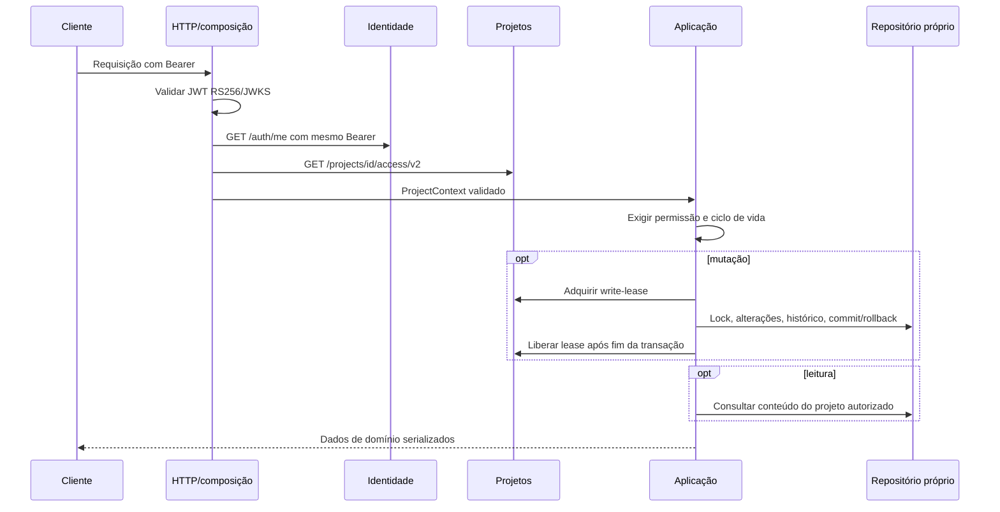

# Arquitetura do Backlog

O conjunto permanece em microsserviços. Este repositório usa apresentação HTTP,
aplicação, domínio e infraestrutura, aproveitando sua estrutura de módulos.
Cada API acessa apenas o próprio schema; comunicação entre serviços usa APIs
com o mesmo Bearer autorizado, sem joins ou FKs entre schemas.

| Camada | Módulos principais | Responsabilidade |
| --- | --- | --- |
| Apresentação | `routes.py`, `item_routes.py`, `recommendation_routes.py`, `review_routes.py` | Contratos JSON/query, status/respostas; sem consultas ORM ou regras de negócio |
| Aplicação | `service.py`, `item_service.py`, `recommendation_service.py`, `review_service.py` | Casos de uso, direitos por ação, coordenação transacional/leases, DAG, versões e aprovação humana |
| Domínio | `domain.py` | Contextos, valores, tipos, validações e erros, sem HTTP/banco/configuração |
| Infraestrutura | `repository.py`, `item_repository.py`, `models.py`, `database.py` | SQL, locks/transações, migração explícita, ORM e persistência no schema próprio |
| Infraestrutura de integração | `security.py`, `identity_status.py`, `project_access.py`, `project_source.py`, `ai_provider.py`, `review_auth.py`, `config.py` | JWT/JWKS, estado online, APIs autorizadas, provider configurável e credencial de integração |
| Composição | `app.py`, `dependencies.py`, `cli.py` | Montagem de clientes, sessões, repositórios, serviços e tradução de erros HTTP |

Serviços de aplicação usam repositórios concretos e dados de domínio; não importam
FastAPI, SQLAlchemy ou modelos ORM e não acessam sessões diretamente. A composição
em `dependencies.py` pode importar HTTP e SQLAlchemy para montar dependências.
Rotas não criam repositórios/clientes nem escolhem as permissões da regra de negócio.

Identidade e acesso atual de Projetos são confirmados sem cache positivo. O contrato
v2 valida IDs, catálogo conhecido, papéis fixos/customizados e união das permissões.
Compatibilidade v1 é opt-in explícito, desabilitado por padrão, sem fallback
automático ou garantia das novas políticas nesse modo. Conta revogada/inativa
retorna 401; dependência inconsistente/indisponível retorna 503 sanitizado.

`StoriesService` preserva `/stories`, campos e ordenação legados; os mesmos UUIDs
são itens expandidos com tipo explícito. Aplicação protege dependências, relações
de mesmo projeto, estimativas, bloqueio e atribuição. Histórico e versões são
transacionais; reorder exige grupo canônico completo e versão do quadro.
Responsáveis indisponíveis permanecem atribuídos e são sinalizados nas leituras.

Recomendações usam projeto autorizado e itens reais; propostas são persistidas e
aprovadas por pessoas antes de criar histórias. Revalidação de contexto, permissões
e versão impede aplicação silenciosa de rascunho antigo. Provider é configurável,
desabilitado por padrão; saída simulada é identificada. O adaptador de revisão é
uma proposta local com autenticação dupla e sem semântica de eventos padrão.

Startup não executa DDL. `backlog-service init` cria tabelas faltantes e aplica
migração aditiva/idempotente de histórias existentes, preservando dados e sem
inventar eventos antigos. Readiness consulta tabela própria; não comprova a
saúde das dependências externas. Artefatos privados ficam fora de Git/pacotes.

Testes AST protegem dependências de domínio/aplicação/apresentação. Testes usam
SQL real sintético e HTTP controlado para isolamento, autorização antes de SQL,
leases após commit/rollback e indisponibilidade. PostgreSQL é apenas loopback
explicitamente configurado, com schemas descartáveis isolados e guarda contra
bancos remotos. Veja [validação](verification.md), [itens](backlog-items.md),
[recomendações](recommendations.md) e [proposta de revisão](code-review-proposal.md).
